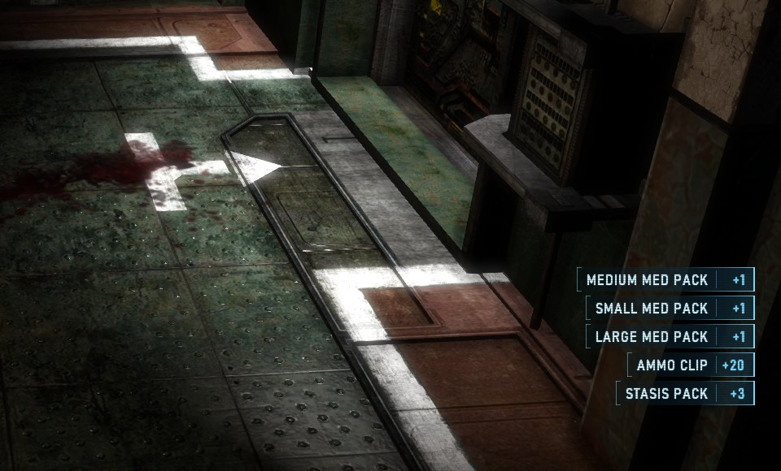
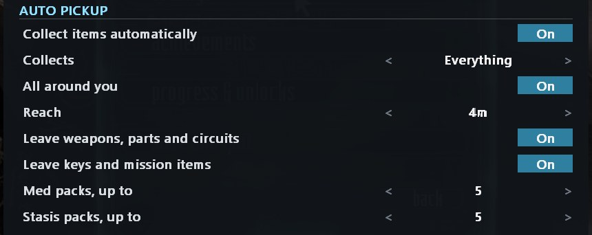

# Auto Pickup

> **This is an add-on for the [DS3 Mod Loader](https://github.com/RHFlyer/Dead-Space-3-Mod-Loader/releases/latest), and needs version 1.0.0 or
> later.** It does nothing without the loader. Install the loader first, then this.

**Collect dropped ammo, packs and resources all around you, without an Ammo Sweeper on your weapon.** A small list
in the bottom-right corner shows what you just picked up.



## What it does

- **Collects items as if every weapon had an Ammo Sweeper attached.** With **All around you** on, it collects in
  every direction within the **Reach** you set, not only in front of you like the game's pickup prompt.
- **Leaves some things for you**, with a switch for each group: weapons, weapon parts, circuits, the Scavenger
  Bot and the Spare Parts Box; and keys and mission items, so that picking one up never starts a scene by surprise.
- **Stops at a number of med and stasis packs**, and keeps some inventory slots free.
- **The pickup list**: one line for each thing you just picked up, with its name and how many (for example
  AMMO CLIP +20), in the corner of the screen. It also lists what you pick up yourself.
- Only your own character's pickups change. A real Ammo Sweeper on your weapon is still checked by the game's own
  rules, for what it collects and how many slots it keeps free; the settings below are for what Auto Pickup itself
  collects.

## Settings

Everything is in the Mods panel (pause, "mods", Auto Pickup). A change applies at once, without a restart.



| Setting | Default | What it does |
|---|---|---|
| Collect items automatically | On | Off: only a real Ammo Sweeper collects, as in the unmodded game. The pickup list keeps working. |
| Collects | Everything | Everything; Ammo, med packs, resources; Ammo and resources; or Ammo only. The Leave switches and pack limits below still apply. |
| All around you | On | On: items are collected in every direction, even ones flying past you. Off: only in front of you, at the game's own reach. |
| Reach | 4 m | How far around you items are collected while All around you is on, from 0 to 10 m. 0: the game's own reach, which is also the shortest it ever gets. |
| Leave weapons, parts and circuits | On | Weapons, weapon parts, circuits, the Scavenger Bot and the Spare Parts Box stay on the floor for you to pick up. |
| Leave keys and mission items | On | Keys and mission items stay where they are. |
| Med packs, up to | 5 | Med packs are no longer collected once you carry this many. You can still pick up more yourself. 0 to 99; 0: no limit. |
| Stasis packs, up to | 5 | The same for stasis packs. |
| Inventory slots kept free | 5 | 0 to 25. A kind of item you don't carry yet is only collected while more than this many slots are free. Resources take no slot, so this never stops them. |

**Pickup list**

| Setting | Default | What it does |
|---|---|---|
| Show the list | On | The list in the bottom-right corner. |
| Lines | 6 | How many lines it shows at once, 1 to 12. |
| Time on screen | 5 s | How long each line stays, 1 to 60 seconds. |
| Text size | 100% | 50% to 300%. |

The list shows what your inventory and resources gained right after a pickup, so crafting, the store and the bench's
storage don't appear in it. It's hidden while the Mods panel is open. It uses the Bahnschrift font that comes with
Windows 10 and later, or the loader's usual font without it.

The settings are kept in `plugins\AutoPickup\auto_pickup.ini`, which the Mods panel creates on your first change.

## Install

1. Install the [DS3 Mod Loader](https://github.com/RHFlyer/Dead-Space-3-Mod-Loader/releases/latest) 1.0.0 or later, if you haven't.
2. **Back up your saves**: copy `Documents\EA Games\Dead Space 3` somewhere safe.
3. Close the game. Download `AutoPickup-v1.0.0.zip` from [Releases](https://github.com/RHFlyer/Dead-Space-3-Auto-Pickup/releases/latest) and unzip it
   into the game folder, next to `deadspace3.exe` (Steam: right-click Dead Space 3 > Manage > Browse local files).
   You get `plugins\AutoPickup\`.
4. Start the game, pause, choose **mods**, switch **Auto Pickup** on, and restart the game.

Auto Pickup is also in the DS3 Mod Loader's add-ons download. If you installed it from there, you already have it,
and unzipping a newer version from this page over it is an update: your switch and settings stay.

**Update**: close the game, unzip the new version into the game folder over the old one, and let Windows replace
the files. Your switch and settings are kept. `CHANGELOG.txt` says what changed.

**Remove**: close the game and delete `plugins\AutoPickup\` (its settings go with it). What you picked up stays in
your inventory. To stop it for a while instead, switch **Collect items automatically** off, or switch Auto Pickup
off in the Mods panel and restart the game.

## Good to know

- Made for the **Steam** version of Dead Space 3. Tested at 1920x1080 with keyboard and mouse.
- **Not yet confirmed in game:** the two Leave switches. During testing no weapon, part, circuit, key or mission
  item came up for the mod to leave, so it hasn't been seen yet that they are left every time. If one is collected
  with its switch on, please report it.
- **Co-op hasn't been tested.** If you try it, please report what happens.
- If your copy of the game differs from the one this mod was made for, Auto Pickup turns off what it can't do
  safely (for example, it then collects only ammo, with no pack limits) and says so in `ds3_mods.log`.
- No game files are changed on disk, the mod reads no account data and makes no network connections.
- Found a bug? [Open an issue](https://github.com/RHFlyer/Dead-Space-3-Auto-Pickup/issues) and attach `ds3_mods.log` from the game folder, where Auto
  Pickup writes its lines. It doesn't hold account details or your Windows user name, but read a log before you post
  it.

## Building from source

Needs Windows, Build Tools for Visual Studio 2022 ("Desktop development with C++") and CMake, as for the
[DS3 Mod Loader](https://github.com/RHFlyer/Dead-Space-3-Mod-Loader).

```
cmake -S . -B build -A Win32
cmake --build build --config Release
```

The mod is then ready in `build\plugins\AutoPickup\`. `scripts\package-mod.ps1` makes the release zip from it.

`ds3mod.h` is a copy of the DS3 Mod Loader's SDK header from loader 1.0.0, the oldest loader this mod works
with. `ds3mod.h.pin` says where it came from, and the build check refuses a changed copy. To learn how a mod like
this is made, start with the loader's guide, [`sdk/README.md`](https://github.com/RHFlyer/Dead-Space-3-Mod-Loader/blob/main/sdk/README.md).
`AutoPickup/auto_pickup.cpp` explains its five hooks at the top of the file.

## How this was made

Like the loader, this mod was made with a lot of help from AI (Claude and Codex), and I tested every release in the
game myself. More in the loader's README, ["How this was made"](https://github.com/RHFlyer/Dead-Space-3-Mod-Loader#how-this-was-made).

## Credits and licence

MIT licence ([`LICENSE.txt`](LICENSE.txt)), by RHFlyer. Like the DS3 Mod Loader, this mod never touches paid DLC,
entitlements, ownership or the game's copy protection.

Dead Space 3 is a trademark of Electronic Arts Inc. This project is not made, endorsed or supported by Electronic
Arts and contains no game files.
